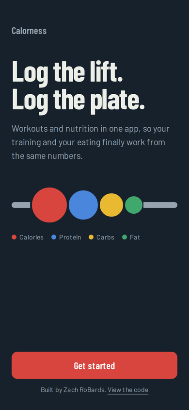
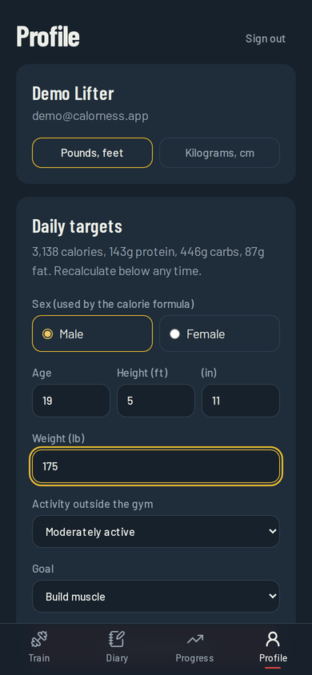

# Calorness

**Log the lift. Log the plate.** A mobile-first fitness app that combines
Hevy-style workout logging with MyFitnessPal-style nutrition tracking, so
training and eating work from the same numbers.

[Live demo](https://calorness.vercel.app). Try it with the demo account, no sign-up needed

| Landing | Train | Profile | Diary |
| --- | --- | --- | --- |
|  |  |  |  |

## Why I built it

My first fitness app, [RoBardsfitnesstracker](https://github.com/zrobards/RoBardsfitnesstracker),
was a React + Vite PWA that stored everything in the browser's localStorage.
It worked for my own training plan, but it couldn't sync between devices,
had my routine hardcoded, and had no nutrition side. Calorness is the rebuild:
real accounts, a Postgres database, user-built routines, and nutrition
tracking that shares data with training.

## Features

**Working now**
- Sign in with GitHub, Google, or a shared demo account
- Calorie and macro targets calculated from your stats (Mifflin–St Jeor + activity level + goal)
- Daily diary showing remaining calories, protein, carbs, and fat
- Pounds/feet or kilograms/centimeters
- Installable to your phone's home screen (PWA)

**Roadmap**
- [ ] Exercise library (800+ exercises) and custom exercises
- [ ] Routines, live workout logging, rest timer, supersets, previous-set values
- [ ] Automatic personal records (heaviest weight, estimated 1RM, best set volume)
- [ ] Food search (USDA FoodData Central) and barcode scanning (Open Food Facts)
- [ ] Recent/frequent foods, custom foods, recipes, water tracking
- [ ] Progress charts: strength, bodyweight, weekly muscle volume
- [ ] Training-aware nutrition: targets that adapt to training volume and weight trend
- [ ] Offline logging in the gym

## Tech stack

| Layer | Choice |
| --- | --- |
| Framework | Next.js 16 (App Router, Server Components, Server Actions) |
| Language | TypeScript |
| Styling | Tailwind CSS v4 |
| Database | PostgreSQL (Neon) with Prisma ORM |
| Auth | NextAuth (Auth.js) with GitHub/Google OAuth |
| Validation | Zod |
| Testing | Vitest |
| CI/CD | GitHub Actions, deployed on Vercel |

## Design

The color system comes from Olympic bumper plates. Each number the app tracks
has its plate color everywhere it appears: red (25 kg) for calories, blue
(20 kg) for protein, yellow (15 kg) for carbs, green (10 kg) for fat.

## Project structure

```
prisma/
  schema.prisma        Database tables: auth, training, nutrition, goals
  migrations/          SQL history, applied automatically on deploy
src/
  app/
    (app)/             Signed-in pages: train, diary, progress, profile
    api/auth/          NextAuth sign-in endpoints
    signin/            Sign-in page
    manifest.ts        PWA manifest (home-screen install)
  components/          Shared UI: bottom nav, macro bars, empty states
  lib/
    auth.ts            Sign-in config + requireUser() access check
    db.ts              Prisma client
    fitness/           Pure, tested logic: 1RM, volume, PRs, BMR/TDEE, macros, units
```

All data is stored in metric; the UI converts to the user's units.

## Running locally

Requires Node 22+ and a Postgres database (a free [Neon](https://neon.tech)
database works, or local Postgres).

```bash
git clone https://github.com/zrobards/calorness.git
cd calorness
npm install
cp .env.example .env      # then fill in the values
npm run db:migrate        # create the tables
npm run dev               # http://localhost:3000
```

| Command | What it does |
| --- | --- |
| `npm run dev` | Start the dev server |
| `npm test` | Run unit tests |
| `npm run typecheck` | Check TypeScript types |
| `npm run lint` | Lint the code |
| `npm run db:migrate` | Create a migration after editing `schema.prisma` |
| `npm run db:studio` | Browse the database in a GUI |
