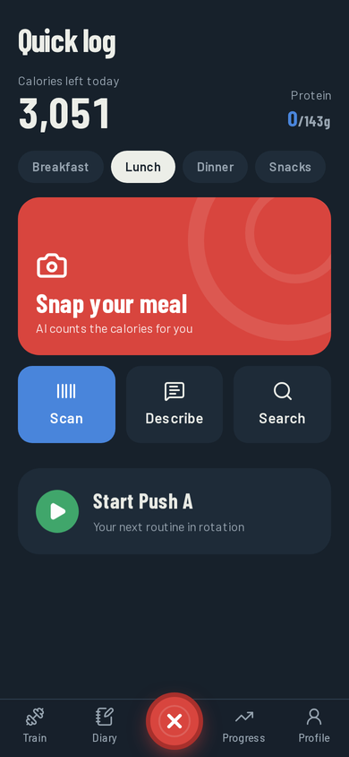
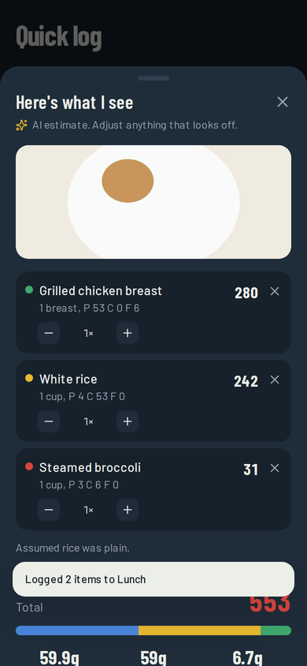
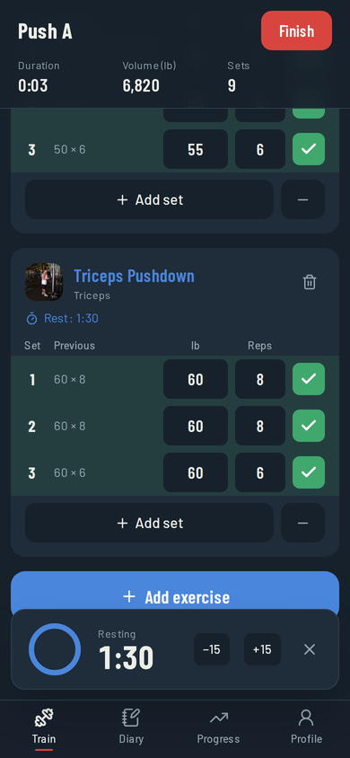
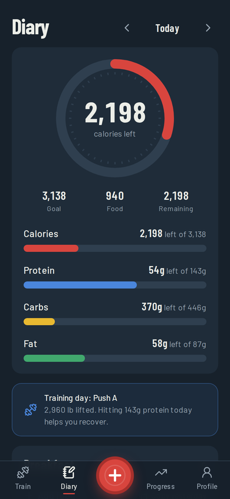
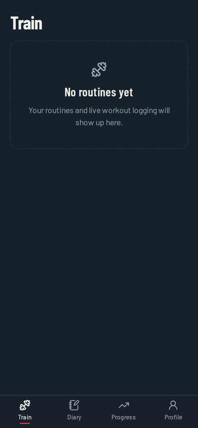
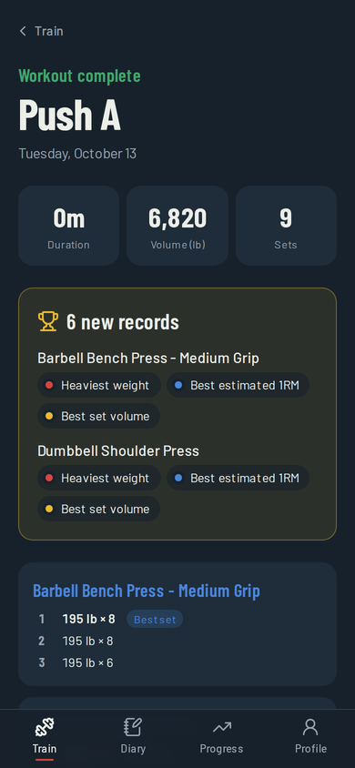
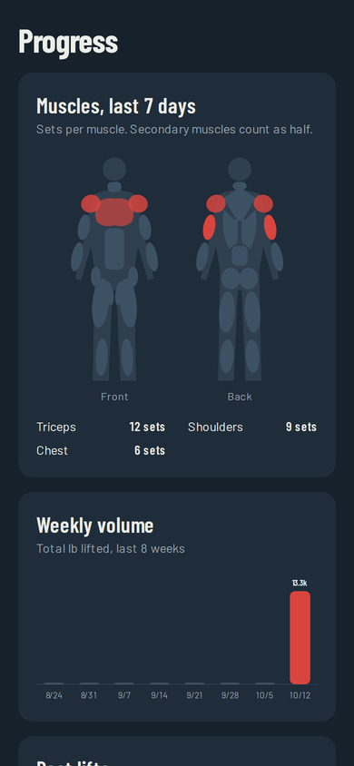
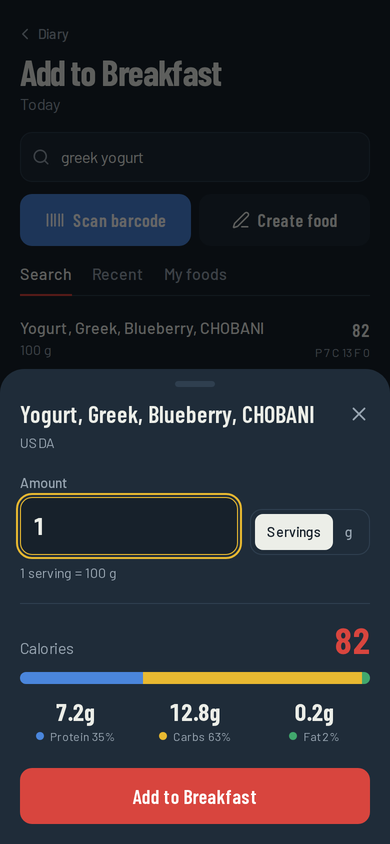
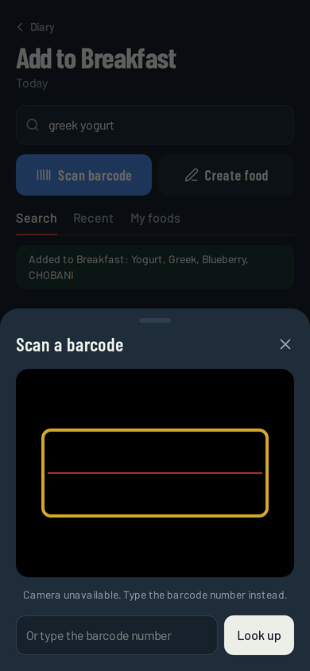
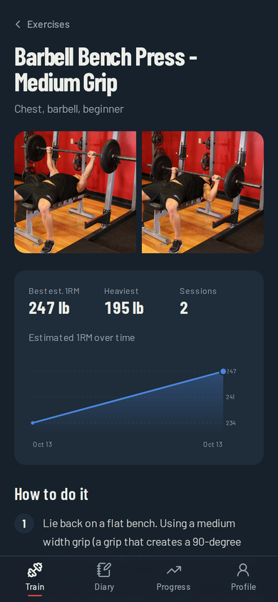

# Calorness

**Log the lift. Log the plate.** A mobile-first fitness app that combines
Hevy-style workout logging with MyFitnessPal-style nutrition tracking, so
training and eating work from the same numbers.

[Live demo](https://calorness.vercel.app). Try it with the demo account, no sign-up needed

| Quick log | AI meal photo | Live workout | Diary |
| --- | --- | --- | --- |
|  |  |  |  |

| Train | Workout summary | Progress |
| --- | --- | --- |
|  |  |  |

| Food diary | Adding a food | Barcode scanner | Exercise detail |
| --- | --- | --- | --- |
|  |  |  |  |

## Why I built it

My first fitness app, [RoBardsfitnesstracker](https://github.com/zrobards/RoBardsfitnesstracker),
was a React + Vite PWA that stored everything in the browser's localStorage.
It worked for my own training plan, but it couldn't sync between devices,
had my routine hardcoded, and had no nutrition side. Calorness is the rebuild:
real accounts, a Postgres database, user-built routines, and nutrition
tracking that shares data with training.

## Features

**Quick log (the center + button)**
- Snap a photo of a meal and Claude (Anthropic's AI) lists each food with calories and macros to review before saving
- Describe a meal in words, or say it out loud with speech-to-text
- Barcode scan and one-tap "log again" for recent foods, with Undo
- Picks the meal from the time of day, shows calories and protein left, and starts your next routine in one tap
- Home-screen shortcuts on Android (long-press the icon): Snap, Scan, Describe, Train

**Training (Hevy-style)**
- Exercise library of 876 exercises with photos, instructions, and muscle groups, searchable and filterable
- Routine builder: sets, rep ranges, and rest time per exercise
- Live workout logger: previous-session values on every set, warm-up/drop/failure sets
- Autosaves every set to the phone instantly and to the server within seconds, so closing the app or switching phones loses nothing; the rest timer survives too
- Keeps the screen awake during a workout, with haptic feedback on supported phones
- Edit a finished workout's sets, or reopen one you ended too early
- Rest timer that starts when you check off a set, with ±15s and vibration
- Automatic personal records: heaviest weight, best estimated 1RM, best set volume
- Exercise pages with your history and an estimated-1RM progress chart

**Progress**
- Muscle map: sets per muscle over the last 7 days, front and back
- Weekly volume for the last 8 weeks, best lifts, bodyweight trend
- Calories eaten over the last 7 days against your goal

**Nutrition (MyFitnessPal-style)**
- Food search across USDA FoodData Central (generic and branded foods) and Open Food Facts, plus your own foods
- Barcode scanning with the phone camera (native BarcodeDetector, with a WebAssembly fallback for iPhone)
- Log by servings or by grams/ml, with a live calorie count and macro split
- Daily diary by meal with a calorie ring and macro bars; tap any entry to edit or delete it
- Recent foods, custom foods (with barcodes that scan next time), and copy a meal from yesterday
- Water tracking by the glass
- Training-day callout in the diary when you worked out, linking to that workout
- Calorie and macro targets calculated from your stats (Mifflin–St Jeor + activity level + goal)

**Feel**
- Motion throughout: count-up numbers, a calorie ring that draws in, bars and charts that grow, cards that rise in, page crossfades (React View Transitions), and a burst of tiny bumper plates when you finish a workout
- Everything respects the phone's "reduce motion" setting

**General**
- Sign in with GitHub, Google, or a shared demo account; stay signed in for 90 days
- Sign-in works inside the iPhone home-screen app too: it hands off to a browser window and matches a 4-digit code, since home-screen apps keep separate cookies
- Pounds/feet or kilograms/centimeters
- Installable to your phone's home screen (PWA)

**Roadmap**
- [x] Exercise library, routines, live workout logging, rest timer, PRs
- [x] Progress charts: muscle map, weekly volume, best lifts, bodyweight
- [x] Food search (USDA + Open Food Facts), barcode scanning, custom foods, recent foods, water
- [x] Calories vs. goal chart on the Progress tab
- [ ] Recipes and saved meals
- [ ] Custom exercises and supersets in the logger
- [ ] Training-aware nutrition: targets that adapt to training volume and weight trend
- [ ] Time zone setting (dates currently display in US Eastern)
- [x] Quick log hub, AI photo/describe logging, workout autosave and editing
- [ ] Apple Health / Google Fit sync and a true home-screen widget (needs a native app)
- [ ] Offline logging in the gym

## Tech stack

| Layer | Choice |
| --- | --- |
| Framework | Next.js 16 (App Router, Server Components, Server Actions) |
| Language | TypeScript |
| Styling | Tailwind CSS v4 |
| Database | PostgreSQL (Neon) with Prisma ORM |
| Auth | NextAuth (Auth.js) with GitHub/Google OAuth |
| Validation | Zod |
| Charts | Hand-built SVG components (no chart library) |
| AI | Claude API (vision + tool use for structured output) |
| Testing | Vitest |
| CI/CD | GitHub Actions, deployed on Vercel |

## Design

The color system comes from Olympic bumper plates. Each number the app tracks
has its plate color everywhere it appears: red (25 kg) for calories, blue
(20 kg) for protein, yellow (15 kg) for carbs, green (10 kg) for fat.

## Project structure

```
prisma/
  schema.prisma        Database tables: auth, training, nutrition, goals
  migrations/          SQL history, applied automatically on deploy
  seed.mjs             Loads the exercise library (runs on every deploy, skips existing)
  data/exercises.json  876 exercises from free-exercise-db (public domain)
src/
  app/
    (app)/             Signed-in pages: train, diary, progress, profile
    api/auth/          NextAuth sign-in endpoints
    signin/            Sign-in page
    manifest.ts        PWA manifest (home-screen install)
  components/          Shared UI: bottom nav, macro bars, empty states
  lib/
    auth.ts            Sign-in config + requireUser() access check
    db.ts              Prisma client
    training.ts        Training queries: workouts, previous sets, records, progress
    nutrition/         Food APIs (USDA, Open Food Facts), normalizing their data, diary queries
    ai/                Claude meal estimation and response validation
    fitness/           Pure, tested logic: 1RM, volume, PRs, BMR/TDEE, macros, units, muscles, dates
```

All data is stored in metric; the UI converts to the user's units.

## Running locally

Requires Node 22+ and a Postgres database (a free [Neon](https://neon.tech)
database works, or local Postgres).

```bash
git clone https://github.com/zrobards/calorness.git
cd calorness
npm install
cp .env.example .env      # then fill in the values
npm run db:migrate        # create the tables
npm run db:seed           # load the exercise library
npm run dev               # http://localhost:3000
```

| Command | What it does |
| --- | --- |
| `npm run dev` | Start the dev server |
| `npm test` | Run unit tests |
| `npm run typecheck` | Check TypeScript types |
| `npm run lint` | Lint the code |
| `npm run db:migrate` | Create a migration after editing `schema.prisma` |
| `npm run db:studio` | Browse the database in a GUI |

## Credits

Food data: [USDA FoodData Central](https://fdc.nal.usda.gov/) (public domain) and [Open Food Facts](https://world.openfoodfacts.org/) (Open Database License).

Exercise data and photos: [free-exercise-db](https://github.com/yuhonas/free-exercise-db) by yuhonas, released into the public domain under the Unlicense.
